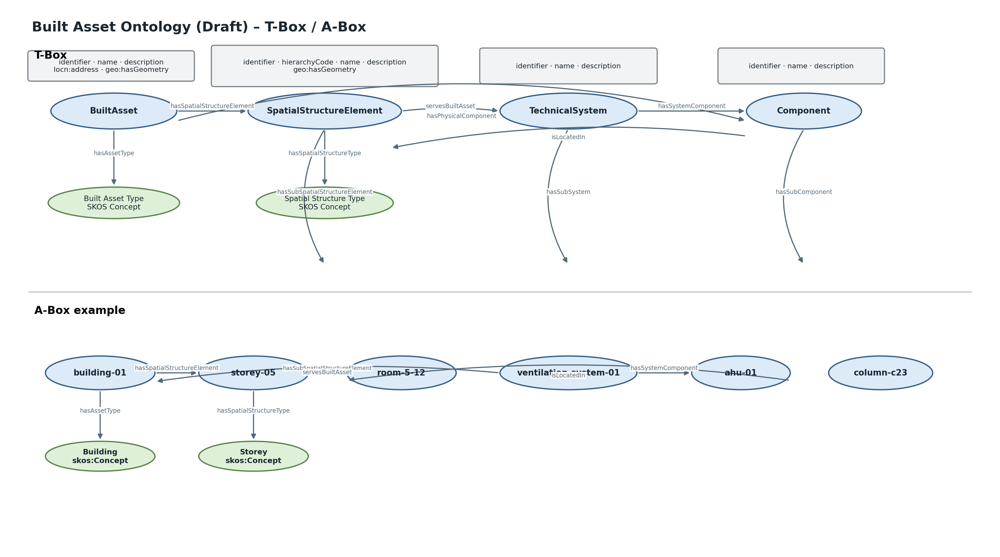

# Built Asset Ontology (Draft)

**Namespace:** `https://www.construct-x.org/ontology/built-asset#`  
**Version:** `0.1.0`  
**Prefix:** `conx-ba`

Die Ontologie beschreibt **dauerhafte Bauwerke des Hoch- und Infrastrukturbaus**. Sie trennt bewusst die intrinsische räumliche Bauwerksstruktur, technische Systeme/Anlagen und physische Komponenten von projektspezifischen Gliederungsstrukturen wie LBS, SBS und CBS.

## Klassen

| Klasse | Deutsch | Fachliche Beschreibung |
|---|---|---|
| `BuiltAsset` | Bauwerk | Dauerhaftes Bauwerk, z. B. Gebäude, Brücke, Tunnel oder Straße. |
| `SpatialStructureElement` | Räumliches Strukturelement | Hierarchisches räumliches Element eines Bauwerks. |
| `TechnicalSystem` | Anlage / technisches System | Funktional zusammengehöriges technisches System aus Subsystemen und Komponenten. |
| `Component` | Komponente | Physische Komponente des Bauwerks oder eines technischen Systems. |

## Eigenschaften

### BuiltAsset

| Property | Wertebereich | Beschreibung |
|---|---|---|
| `identifier` | `xsd:string` | Fachliche Kennung des Bauwerks. |
| `name` | `xsd:string` | Bezeichnung. |
| `description` | `xsd:string` | Kurzbeschreibung. |
| `hasAssetType` | `skos:Concept` | Typ des Bauwerks. |
| `hasSpatialStructureElement` | `SpatialStructureElement` | Räumliches Strukturelement des Bauwerks. |
| `hasPhysicalComponent` | `Component` | Physische Komponente des Bauwerks. |
| `hasTechnicalSystem` | `TechnicalSystem` | Technisches System, das das Bauwerk versorgt. |
| `locn:address` | `locn:Address` | Standardisierte Adresse über das Core Location Vocabulary. |
| `geo:hasGeometry` | `geo:Geometry` | Optionale Geometrie über GeoSPARQL. |

### SpatialStructureElement

| Property | Wertebereich | Beschreibung |
|---|---|---|
| `identifier` | `xsd:string` | Fachliche Kennung. |
| `hierarchyCode` | `xsd:string` | Gliederungsnummer innerhalb der räumlichen Hierarchie. |
| `name` | `xsd:string` | Bezeichnung. |
| `description` | `xsd:string` | Kurzbeschreibung. |
| `isSpatialStructureElementOf` | `BuiltAsset` | Bauwerk, zu dem das räumliche Element gehört. |
| `hasSpatialStructureType` | `skos:Concept` | Typ des räumlichen Elements. |
| `hasSubSpatialStructureElement` | `SpatialStructureElement` | Direkt untergeordnetes räumliches Element. |
| `isSubSpatialStructureElementOf` | `SpatialStructureElement` | Direkt übergeordnetes räumliches Element. |
| `geo:hasGeometry` | `geo:Geometry` | Optionale Geometrie über GeoSPARQL. |

Die räumliche Struktur ist bewusst **nicht auf Gebäude beschränkt**. Dadurch können beispielsweise Geschosse und Räume ebenso wie Tunnelabschnitte oder Brückensegmente modelliert werden.

### TechnicalSystem

| Property | Wertebereich | Beschreibung |
|---|---|---|
| `identifier` | `xsd:string` | Fachliche Kennung. |
| `name` | `xsd:string` | Bezeichnung. |
| `description` | `xsd:string` | Kurzbeschreibung. |
| `servesBuiltAsset` | `BuiltAsset` | Bauwerk, das durch das System versorgt wird. |
| `servesSpatialStructureElement` | `SpatialStructureElement` | Räumlicher Bereich, den das System versorgt. |
| `hasSubSystem` | `TechnicalSystem` | Direktes Subsystem. |
| `isSubSystemOf` | `TechnicalSystem` | Direktes übergeordnetes System. |
| `hasSystemComponent` | `Component` | Physische Komponente des Systems. |

Ein `TechnicalSystem` ist **nicht Bestandteil der räumlichen Hierarchie**. Dadurch kann z. B. ein Energieversorgungssystem außerhalb des eigentlichen Bauwerks liegen und dennoch das Bauwerk versorgen.

### Component

| Property | Wertebereich | Beschreibung |
|---|---|---|
| `identifier` | `xsd:string` | Fachliche Kennung. |
| `name` | `xsd:string` | Bezeichnung. |
| `description` | `xsd:string` | Kurzbeschreibung. |
| `isPhysicalComponentOf` | `BuiltAsset` | Bauwerk, zu dem die Komponente gehört. |
| `isLocatedIn` | `SpatialStructureElement` | Räumlicher Ort der Komponente. |
| `hasSubComponent` | `Component` | Direkt untergeordnete Komponente. |
| `isSubComponentOf` | `Component` | Direkt übergeordnete Komponente. |

## Vokabulare

### Built Asset Type

`https://www.construct-x.org/vocab/built-asset/asset-type#`

`Building`, `Bridge`, `Tunnel`, `Road`, `Railway`, `MarineFacility`, `OtherInfrastructure`

### Spatial Structure Type

`https://www.construct-x.org/vocab/built-asset/spatial-structure-type#`

`Storey`, `Space`, `Section`, `Segment`, `Zone`, `Part`

Die konkreten Typen sind **SKOS-Konzepte und keine OWL-Klassen**.

## Externe Standards

- **GeoSPARQL** für Geometrien (`geo:hasGeometry`, `geo:Geometry`)
- **Core Location Vocabulary** für Adressen (`locn:address`, `locn:Address`)

Diese Standardvokabulare werden direkt wiederverwendet und nicht als Construct-X-Fachontologien neu modelliert.

## Externe Verknüpfungen

### Built Asset ↔ Breakdown

`built-asset-breakdown-link`

- `SpatialStructureElement → LBSNode`
- `TechnicalSystem → SBSNode`
- `BuiltAsset / TechnicalSystem / Component → CBSNode`

### Construction Site ↔ Built Asset

`site-built-asset-link`

- `ConstructionField → BuiltAsset`
- `SiteArea → SpatialStructureElement`

Damit bleiben temporäre Baustellenstruktur und dauerhaftes Bauwerk getrennt.

## SHACL

Core:
`https://www.construct-x.org/shapes/built-asset/core/0.1.0`

Vokabularprofil:
`https://www.construct-x.org/shapes/built-asset/vocabularies/0.1.0`

Der Core prüft insbesondere:
- genau eine fachliche Kennung pro Ressource,
- genau einen Bauwerkstyp,
- mindestens ein räumliches Strukturelement je Bauwerk,
- genau einen räumlichen Strukturtyp je räumlichem Element,
- keine Zyklen in räumlicher Struktur, Systemstruktur und Komponentenhierarchie.

## Grundprinzip

```text
BuiltAsset
├── SpatialStructureElement
│      └── SpatialStructureElement
├── TechnicalSystem
│      ├── TechnicalSystem
│      └── Component
└── Component
       └── Component
```

Räumliche Struktur, technische Systemstruktur und physische Komponenten sind voneinander getrennte, miteinander verknüpfbare Sichten.

## Ontologievisualisierung


