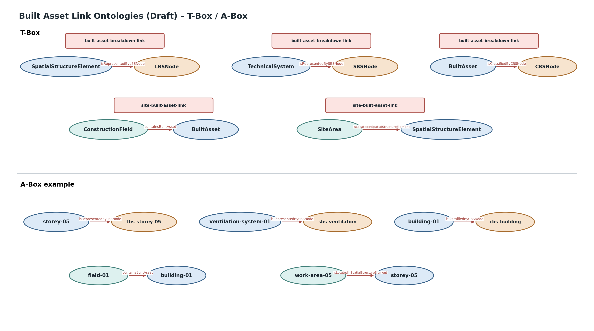

# Built Asset Link Ontologies (Draft)

Die Built Asset Ontology definiert ausschließlich die intrinsische Struktur des dauerhaften Bauwerks. Projektspezifische Gliederungsstrukturen und der Bezug zur temporären Baustellenumgebung werden über separate Link-Ontologien angebunden.

## Built Asset–Breakdown Link

**Namespace:** `https://www.construct-x.org/ontology/built-asset-breakdown-link#`  
**Version:** `0.1.0`

| Quelle | Property | Ziel | Bedeutung |
|---|---|---|---|
| `SpatialStructureElement` | `isRepresentedByLBSNode` | `LBSNode` | räumliches Bauwerkselement ↔ projektspezifische Ortsstruktur |
| `LBSNode` | `representsSpatialStructureElement` | `SpatialStructureElement` | inverse Beziehung |
| `TechnicalSystem` | `isRepresentedBySBSNode` | `SBSNode` | technisches System ↔ projektspezifische Systemstruktur |
| `SBSNode` | `representsTechnicalSystem` | `TechnicalSystem` | inverse Beziehung |
| `BuiltAsset`, `TechnicalSystem`, `Component` | `isClassifiedByCBSNode` | `CBSNode` | kostentechnische Einordnung |

Damit gilt:

```text
SpatialStructureElement ── isRepresentedByLBSNode ──► LBSNode
TechnicalSystem         ── isRepresentedBySBSNode ──► SBSNode
BuiltAsset/System/Component ─ isClassifiedByCBSNode ─► CBSNode
```

Die Breakdown Structure bleibt damit eine projektspezifische Strukturierungs- und Klassifikationssicht und wird nicht in die Built Asset Ontology dupliziert.

## Site–Built Asset Link

**Namespace:** `https://www.construct-x.org/ontology/site-built-asset-link#`  
**Version:** `0.1.0`

| Quelle | Property | Ziel | Bedeutung |
|---|---|---|---|
| `ConstructionField` | `containsBuiltAsset` | `BuiltAsset` | dauerhaftes Bauwerk im temporären Baufeld |
| `BuiltAsset` | `isLocatedInConstructionField` | `ConstructionField` | inverse Beziehung |
| `SiteArea` | `isLocatedInSpatialStructureElement` | `SpatialStructureElement` | temporäre Baustellenfläche innerhalb einer dauerhaften räumlichen Bauwerksstruktur |
| `SpatialStructureElement` | `containsSiteArea` | `SiteArea` | inverse Beziehung |

Beispiel:

```text
ConstructionField
     └── containsBuiltAsset
              ↓
          BuiltAsset
              └── SpatialStructureElement
                         ↑
                         │ isLocatedInSpatialStructureElement
                      SiteArea
```

Damit bleibt die zentrale Trennung erhalten:

```text
Construction Site = temporäre Produktionsumgebung
Built Asset        = dauerhaftes Bauwerk
```

## Ontologievisualisierung


