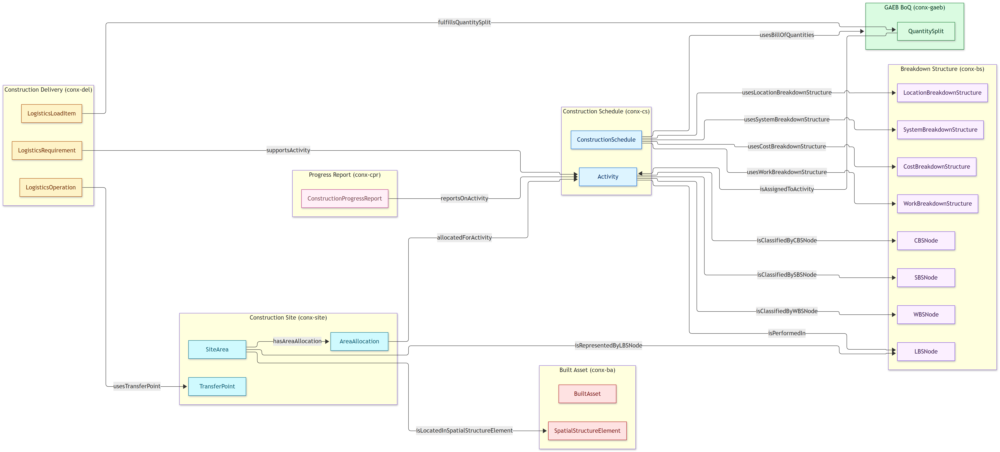

# Construct-X Verknüpfungsontologien (Draft)

Die Verknüpfungsontologien verbinden Klassen aus unterschiedlichen Construct-X-Fachontologien. Die Beziehungen werden **nicht in den Fachontologien selbst**, sondern ausschließlich in separaten Link-Ontologien definiert.

Damit bleiben die Fachontologien unabhängig wiederverwendbar und domänenübergreifende Beziehungen können separat versioniert und validiert werden.

---

## Übersicht

| Link-Ontologie | Verknüpfte Fachontologien | Zweck |
|---|---|---|
| `schedule-breakdown-link` | Construction Schedule ↔ Breakdown Structure | Zuordnung eines Terminplans zu Gliederungsstrukturen sowie eines Vorgangs zu Gliederungsknoten |
| `schedule-boq-link` | Construction Schedule ↔ GAEB BoQ | Zuordnung eines Terminplans zu Leistungsverzeichnissen sowie von Mengensplits zu Vorgängen |
| `schedule-progress-report-link` | Construction Schedule ↔ Construction Progress Report | Zuordnung einer Baufortschrittsmeldung zu einem Vorgang |
| `site-breakdown-link` | Construction Site ↔ Breakdown Structure | Zuordnung einer Baustellenfläche (SiteArea) zu einem LBS-Knoten |
| `delivery-site-link` | Construction Delivery ↔ Construction Site | Zuordnung eines Logistikvorgangs zu einem Übergabepunkt der Baustelle |
| `delivery-boq-link` | Construction Delivery ↔ GAEB BoQ | Zuordnung einer Ladungsposition zu einem Mengensplit des LV |
| `schedule-delivery-link` | Construction Schedule ↔ Construction Delivery | Zuordnung einer Logistikanforderung zu einem Terminplanvorgang |
| `schedule-site-link` | Construction Schedule ↔ Construction Site | Zuordnung einer zeitlich begrenzten Flächenbelegung (AreaAllocation) zu einem Terminplanvorgang |
| `site-built-asset-link` | Construction Site ↔ Built Asset | Zuordnung einer Baustellenfläche (SiteArea) zu einem räumlichen Strukturelement des Bauwerks |

Der Construction Schedule bildet damit die zentrale Integrationsachse. Die Construction Delivery ist über drei Link-Ontologien an Schedule, Site und BoQ angebunden. Die zeitlich veränderliche Flächenbelegung wird über `schedule-site-link` an den Terminplan gekoppelt; das dauerhafte Bauwerk wird über `site-built-asset-link` an die Baustelle angebunden.

```text
                 Breakdown Structure
                 ▲                   ▲
                 │                   │
   schedule-breakdown-link   site-breakdown-link
                 │                   │
                 │            Construction Site
                 │            ▲     ▲     ▲
                 │            │     │     │
                 │   schedule-site-link  site-built-asset-link
                 │            │     │     │
                 │            │     │  Built Asset
                 │            │     │
                 │          delivery-site-link
                 │                   │
        Construction Schedule   Construction Delivery
        ▲                   ▲       ▲
        │                   │       │
 schedule-boq-link   schedule-progress-report-link   delivery-boq-link
        │                   │                               │
     GAEB BoQ       Progress Report                    GAEB BoQ
```

---

# Schedule–Breakdown Link Ontology

**Namespace:** `https://www.construct-x.org/ontology/schedule-breakdown-link#`  
**Prefix:** `conx-sbl`  
**Status:** Draft

Die Link-Ontologie verbindet einen `ConstructionSchedule` mit den für den Terminplan verwendeten Gliederungsstrukturen. Zusätzlich können einzelne `Activity`-Instanzen konkreten Knoten der jeweiligen Breakdown Structure zugeordnet werden.

## Eigenschaften

### ConstructionSchedule

| Property | Wertebereich | Beschreibung |
|---|---|---|
| `usesBreakdownStructure` | `BreakdownStructure` | Generische Oberrelation zu einer vom Terminplan verwendeten Gliederungsstruktur. |
| `usesWorkBreakdownStructure` | `WorkBreakdownStructure` | Verwendete Work Breakdown Structure (WBS). |
| `usesLocationBreakdownStructure` | `LocationBreakdownStructure` | Verwendete Location Breakdown Structure (LBS). |
| `usesSystemBreakdownStructure` | `SystemBreakdownStructure` | Verwendete System Breakdown Structure (SBS). |
| `usesCostBreakdownStructure` | `CostBreakdownStructure` | Verwendete Cost Breakdown Structure (CBS). |

Die vier spezialisierten Properties sind Spezialisierungen von `usesBreakdownStructure`.

Damit gilt:

```text
ConstructionSchedule
├── usesWorkBreakdownStructure     → WorkBreakdownStructure
├── usesLocationBreakdownStructure → LocationBreakdownStructure
├── usesSystemBreakdownStructure   → SystemBreakdownStructure
└── usesCostBreakdownStructure     → CostBreakdownStructure
```

### Activity

| Property | Wertebereich | Beschreibung |
|---|---|---|
| `isClassifiedByWBSNode` | `WBSNode` | Fachliche Einordnung des Vorgangs in die WBS. |
| `isPerformedIn` | `LBSNode` | Räumliche Zuordnung des Vorgangs. |
| `isClassifiedBySBSNode` | `SBSNode` | Systembezogene Einordnung des Vorgangs. |
| `isClassifiedByCBSNode` | `CBSNode` | Kostenbezogene Einordnung des Vorgangs. |

Damit gilt:

```text
Activity
├── isClassifiedByWBSNode → WBSNode
├── isPerformedIn         → LBSNode
├── isClassifiedBySBSNode → SBSNode
└── isClassifiedByCBSNode → CBSNode
```

`isPerformedIn` besitzt bewusst eine eigene fachliche Semantik. Die LBS beschreibt den Ort der Ausführung und nicht lediglich eine Klassifikation.

---

# Schedule–BoQ Link Ontology

**Namespace:** `https://www.construct-x.org/ontology/schedule-boq-link#`  
**Prefix:** `conx-sbq`  
**Status:** Draft

Die Link-Ontologie verbindet einen Bauablaufplan mit den von ihm verwendeten Leistungsverzeichnissen. Zusätzlich kann ein `QuantitySplit` einem konkreten Vorgang zugeordnet werden.

## Eigenschaften

| Quelle | Property | Ziel | Fachliche Bedeutung |
|---|---|---|---|
| `ConstructionSchedule` | `usesBillOfQuantities` | `BillOfQuantities` | Leistungsverzeichnis, das vom Terminplan verwendet wird |
| `QuantitySplit` | `isAssignedToActivity` | `Activity` | Vorgang, dem die Teilmenge zur Ausführung zugeordnet ist |

Damit gilt:

```text
ConstructionSchedule
    └── usesBillOfQuantities
            ↓
      BillOfQuantities

QuantitySplit
    └── isAssignedToActivity
            ↓
         Activity
```

`usesBillOfQuantities` ist nicht funktional. Ein Terminplan kann mehrere Leistungsverzeichnisse verwenden.

Die Zuordnung auf Ausführungsebene erfolgt bewusst über `QuantitySplit` und nicht direkt über `BoQItem`, da Teilmengen einer Position unterschiedlichen Vorgängen zugeordnet werden können.

---

# Schedule–Progress Report Link Ontology

**Namespace:** `https://www.construct-x.org/ontology/schedule-progress-report-link#`  
**Prefix:** `conx-sprl`  
**Status:** Draft

Die Link-Ontologie verbindet eine zeitpunktbezogene Baufortschrittsmeldung mit genau dem Vorgang, dessen Fortschrittsstand dokumentiert wird.

## Eigenschaften

| Quelle | Property | Ziel | Fachliche Bedeutung |
|---|---|---|---|
| `ConstructionProgressReport` | `reportsOnActivity` | `Activity` | Vorgang, dessen Fortschrittsstand gemeldet wird |

Damit gilt:

```text
ConstructionProgressReport
    └── reportsOnActivity
            ↓
         Activity
```

Die Baufortschrittsmeldung enthält den zeitbezogenen Zustand. Die Verbindung zum Vorgang selbst liegt ausschließlich in der Link-Ontologie.

---

# Site–Breakdown Link Ontology

**Namespace:** `https://www.construct-x.org/ontology/site-breakdown-link#`  
**Prefix:** `conx-sbdl`  
**Status:** Draft

Die Link-Ontologie verbindet eine operative Baustellenfläche (`SiteArea`) mit dem LBS-Knoten, der dieselbe räumliche bzw. logistische Fläche in einer Location Breakdown Structure repräsentiert.

## Eigenschaften

| Quelle | Property | Ziel | Fachliche Bedeutung |
|---|---|---|---|
| `SiteArea` | `isRepresentedByLBSNode` | `LBSNode` | LBS-Knoten, der die Fläche in der LBS repräsentiert |
| `LBSNode` | `representsSiteArea` | `SiteArea` | Inverse Relation: Fläche, die der LBS-Knoten repräsentiert |

Damit gilt:

```text
SiteArea
    └── isRepresentedByLBSNode
            ↓
         LBSNode
```

Damit lassen sich die räumliche Modellierung der Baustelle (Site) und die projektbezogene Gliederung (LBS) konsistent aufeinander beziehen, ohne dass eine der beiden Fachontologien die andere importieren muss.

---

# Delivery–Site Link Ontology

**Namespace:** `https://www.construct-x.org/ontology/delivery-site-link#`  
**Prefix:** `conx-dsl`  
**Status:** Draft

Die Link-Ontologie verbindet einen Logistikvorgang mit dem Übergabepunkt der Baustelle, der von diesem Vorgang genutzt wird.

## Eigenschaften

| Quelle | Property | Ziel | Fachliche Bedeutung |
|---|---|---|---|
| `LogisticsOperation` | `usesTransferPoint` | `TransferPoint` | Übergabepunkt, der vom Logistikvorgang genutzt wird (funktional) |

Damit gilt:

```text
LogisticsOperation
    └── usesTransferPoint
            ↓
       TransferPoint
```

Der Übergabepunkt selbst ist Teil der Construction Site Ontology; die Delivery-Ontologie bleibt dadurch räumlich unabhängig.

---

# Delivery–BoQ Link Ontology

**Namespace:** `https://www.construct-x.org/ontology/delivery-boq-link#`  
**Prefix:** `conx-dbl`  
**Status:** Draft

Die Link-Ontologie verbindet eine Ladungsposition mit dem Mengensplit des Leistungsverzeichnisses, dessen Menge sie ganz oder teilweise erfüllt.

## Eigenschaften

| Quelle | Property | Ziel | Fachliche Bedeutung |
|---|---|---|---|
| `LogisticsLoadItem` | `fulfillsQuantitySplit` | `QuantitySplit` | Mengensplit, dessen Menge die Ladungsposition erfüllt (funktional) |

Damit gilt:

```text
LogisticsLoadItem
    └── fulfillsQuantitySplit
            ↓
       QuantitySplit
```

Die Zuordnung erfolgt bewusst auf Ebene des `QuantitySplit` und nicht der `BoQItem`, da eine Position in mehrere Mengensplits aufgeteilt sein kann, die unterschiedlichen Lieferungen zugeordnet werden.

---

# Schedule–Delivery Link Ontology

**Namespace:** `https://www.construct-x.org/ontology/schedule-delivery-link#`  
**Prefix:** `conx-sdl`  
**Status:** Draft

Die Link-Ontologie verbindet eine Logistikanforderung mit dem Terminplanvorgang, dessen Ausführung sie unterstützt.

## Eigenschaften

| Quelle | Property | Ziel | Fachliche Bedeutung |
|---|---|---|---|
| `LogisticsRequirement` | `supportsActivity` | `Activity` | Vorgang, dessen Ausführung die Logistikanforderung unterstützt |
| `Activity` | `requiresLogisticsRequirement` | `LogisticsRequirement` | Inverse Relation: Logistikanforderung, die der Vorgang benötigt |

Damit gilt:

```text
LogisticsRequirement
    └── supportsActivity
            ↓
         Activity
```

Ein Vorgang kann mehrere Logistikanforderungen benötigen (z. B. Materialanlieferung und Kranbereitstellung); die Relation ist daher nicht funktional.

---

# Schedule–Site Link Ontology

**Namespace:** `https://www.construct-x.org/ontology/schedule-site-link#`  
**Prefix:** `conx-ssl`  
**Status:** Draft

Die Link-Ontologie verbindet eine zeitlich begrenzten Flächenbelegung (`AreaAllocation`) mit dem Terminplanvorgang, für den die Fläche belegt ist. Damit wird die zeitlich veränderliche Flächenbelegung der Baustelle an den Terminplan gekoppelt.

## Eigenschaften

| Quelle | Property | Ziel | Fachliche Bedeutung |
|---|---|---|---|
| `AreaAllocation` | `allocatedForActivity` | `Activity` | Vorgang, für den die Fläche im Belegungszeitraum belegt ist |
| `Activity` | `requiresAreaAllocation` | `AreaAllocation` | Inverse Relation: Flächenbelegung, die der Vorgang benötigt |

Damit gilt:

```text
AreaAllocation (validFrom … validTo)
    └── allocatedForActivity
            ↓
         Activity
```

Ein Vorgang kann mehrere Flächenbelegungen benötigen (z. B. Ladezone und Zwischenlager); die Relation ist daher nicht funktional.

---

# Site–Built Asset Link Ontology

**Namespace:** `https://www.construct-x.org/ontology/site-built-asset-link#`  
**Prefix:** `conx-sbal`  
**Status:** Draft

Die Link-Ontologie verbindet die temporäre Baustellensicht mit der dauerhaften Bauwerksstruktur. Sie verknüpft ein Baufeld (`ConstructionField`) mit dem Bauwerk, das sich in ihm befindet, sowie eine Baustellenfläche (`SiteArea`) mit dem räumlichen Strukturelement des Bauwerks, in dem sie liegt.

## Eigenschaften

| Quelle | Property | Ziel | Fachliche Bedeutung |
|---|---|---|---|
| `ConstructionField` | `containsBuiltAsset` | `BuiltAsset` | Bauwerk, das sich im Baufeld befindet |
| `BuiltAsset` | `isLocatedInConstructionField` | `ConstructionField` | Inverse Relation: Baufeld, in dem das Bauwerk liegt |
| `SiteArea` | `isLocatedInSpatialStructureElement` | `SpatialStructureElement` | Strukturelement des Bauwerks, in dem die Baustellenfläche liegt |
| `SpatialStructureElement` | `containsSiteArea` | `SiteArea` | Inverse Relation: Baustellenfläche, die das Strukturelement enthält |

Damit gilt:

```text
ConstructionField
    └── containsBuiltAsset
            ↓
         BuiltAsset
             ▲
             │ isLocatedInSpatialStructureElement
         SiteArea
```

---

## Bewusst nicht modellierte direkte Verknüpfungen

Zwischen den übrigen Fachontologien werden derzeit keine zusätzlichen direkten Link-Ontologien benötigt.

Insbesondere werden nicht modelliert:

```text
GAEB BoQ ↔ Breakdown Structure
Progress Report ↔ Breakdown Structure
Progress Report ↔ GAEB BoQ
Delivery ↔ Breakdown Structure
```

Diese Beziehungen können über die `Activity` bzw. über die Delivery-Kette hergeleitet werden.

Beispiel:

```text
QuantitySplit
    └── isAssignedToActivity
            ↓
         Activity
            ├── isClassifiedByWBSNode → WBSNode
            └── isPerformedIn         → LBSNode
```

und:

```text
ConstructionProgressReport
    └── reportsOnActivity
            ↓
         Activity
            ├── isClassifiedByWBSNode → WBSNode
            └── isPerformedIn         → LBSNode
```

Dadurch werden redundante und potenziell widersprüchliche Zuordnungen vermieden.

---

## T-Box

Die T-Box zeigt ausschließlich die Klassen der beteiligten Fachontologien sowie die in den Link-Ontologien definierten domänenübergreifenden ObjectProperties.



---

## A-Box-Beispiel

```turtle
@prefix conx-cs:   <https://www.construct-x.org/ontology/construction-schedule#> .
@prefix conx-bs:   <https://www.construct-x.org/ontology/breakdown-structure#> .
@prefix conx-gaeb: <https://www.construct-x.org/ontology/gaeb-boq#> .
@prefix conx-cpr:  <https://www.construct-x.org/ontology/construction-progress-report#> .
@prefix conx-sbl:  <https://www.construct-x.org/ontology/schedule-breakdown-link#> .
@prefix conx-sbq:  <https://www.construct-x.org/ontology/schedule-boq-link#> .
@prefix conx-sprl: <https://www.construct-x.org/ontology/schedule-progress-report-link#> .
@prefix ex:        <https://data.example.com/project/alpha/> .

ex:schedule-01
    a conx-cs:ConstructionSchedule ;
    conx-sbl:usesWorkBreakdownStructure ex:wbs-01 ;
    conx-sbl:usesLocationBreakdownStructure ex:lbs-01 ;
    conx-sbl:usesSystemBreakdownStructure ex:sbs-01 ;
    conx-sbl:usesCostBreakdownStructure ex:cbs-01 ;
    conx-sbq:usesBillOfQuantities ex:boq-01 .

ex:activity-A100
    a conx-cs:Activity ;
    conx-sbl:isClassifiedByWBSNode ex:wbs-120 ;
    conx-sbl:isPerformedIn ex:lbs-eg ;
    conx-sbl:isClassifiedBySBSNode ex:sbs-10 ;
    conx-sbl:isClassifiedByCBSNode ex:cbs-300 .

ex:split-001
    a conx-gaeb:QuantitySplit ;
    conx-sbq:isAssignedToActivity ex:activity-A100 .

ex:progress-report-A100
    a conx-cpr:ConstructionProgressReport ;
    conx-sprl:reportsOnActivity ex:activity-A100 .
```

---

## Grundprinzip

```text
Verknüpfungsontologien
        │
        ├─ enthalten ausschließlich domänenübergreifende Beziehungen
        │
        ├─ importieren die beteiligten Fachontologien
        │
        ├─ definieren keine Klassen der Fachontologien neu
        │
        └─ halten die Fachontologien unabhängig voneinander
```

Die Verknüpfungsontologien bilden damit die semantische Integrationsschicht zwischen Construction Schedule, Breakdown Structure, GAEB BoQ und Construction Progress Report.

---

## Hinweis zum aktuellen Dateienstand

Diese Dokumentation beschreibt den **zuletzt abgestimmten Draft-Zielstand**.

Die Link-Ontologie enthält im vorliegenden Draft-Stand die Verknüpfungen zu WBS, LBS, SBS und CBS.

Die übrigen beiden dokumentierten Beziehungen `usesBillOfQuantities` / `isAssignedToActivity` sowie `reportsOnActivity` entsprechen dem zuletzt vorliegenden Link-Modell.
