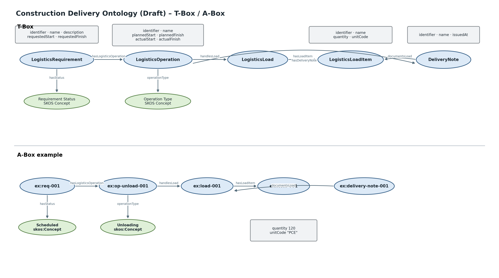

# Construction Delivery Ontology (Draft)

**Namespace:** `https://www.construct-x.org/ontology/construction-delivery#`  
**Version:** `0.1.0`  
**Prefix:** `conx-del`

Die Ontologie beschreibt den Anlieferungsprozess einer Baustelle mit Logistikanforderungen, operativen Logistikvorgängen, Ladungen, Ladungspositionen und Lieferscheinen.

## Klassen

| Klasse | Deutsch | Fachliche Beschreibung |
|---|---|---|
| `LogisticsRequirement` | Logistikanforderung | Bedarf bzw. Anforderung, die eine Anlieferung auslöst. |
| `LogisticsOperation` | Logistikvorgang | Operativer Schritt innerhalb einer Anlieferung. |
| `LogisticsLoad` | Ladung | Physische Ladung. |
| `LogisticsLoadItem` | Ladungsposition | Mengenmäßig beschriebener Bestandteil einer Ladung. |
| `DeliveryNote` | Lieferschein | Dokumentiert eine oder mehrere Ladungen. |

## Eigenschaften

### LogisticsRequirement

| Property | Wertebereich |
|---|---|
| `identifier` | `xsd:string` |
| `name` | `xsd:string` |
| `description` | `xsd:string` |
| `requestedStart` | `xsd:dateTime` |
| `requestedFinish` | `xsd:dateTime` |
| `hasStatus` | `skos:Concept` |
| `hasLogisticsOperation` | `LogisticsOperation` |

### LogisticsOperation

| Property | Wertebereich |
|---|---|
| `identifier` | `xsd:string` |
| `name` | `xsd:string` |
| `operationType` | `skos:Concept` |
| `plannedStart` | `xsd:dateTime` |
| `plannedFinish` | `xsd:dateTime` |
| `actualStart` | `xsd:dateTime` |
| `actualFinish` | `xsd:dateTime` |
| `handlesLoad` | `LogisticsLoad` |
| `hasDeliveryNote` | `DeliveryNote` |
| `isOperationOf` | `LogisticsRequirement` |

### LogisticsLoad / LogisticsLoadItem

`LogisticsLoad` enthält über `hasLoadItem` mindestens eine `LogisticsLoadItem`.

Eine Ladungsposition besitzt:
- `identifier`
- `name`
- `quantity`
- `unitCode`
- `isLoadItemOf`

### DeliveryNote

`DeliveryNote` besitzt eine Kennung, optional `issuedAt` und dokumentiert über `documentsLoad` mindestens eine Ladung.

## Vokabulare

### Logistics Requirement Status
`https://www.construct-x.org/vocab/construction-delivery/requirement-status#`

`Requested`, `Confirmed`, `Scheduled`, `InProgress`, `Completed`, `Cancelled`

### Logistics Operation Type
`https://www.construct-x.org/vocab/construction-delivery/operation-type#`

`Arrival`, `Waiting`, `CheckIn`, `Loading`, `Unloading`, `InternalTransport`, `Lifting`, `Handover`

## Abgrenzung

Der räumliche `TransferPoint` gehört nicht in diese Ontologie, sondern in die Construction Site Ontology. Beziehungen zu Baustellenflächen, Terminplanvorgängen und BoQ-Mengen werden über Link-Ontologien definiert.

## Ontologievisualisierung

