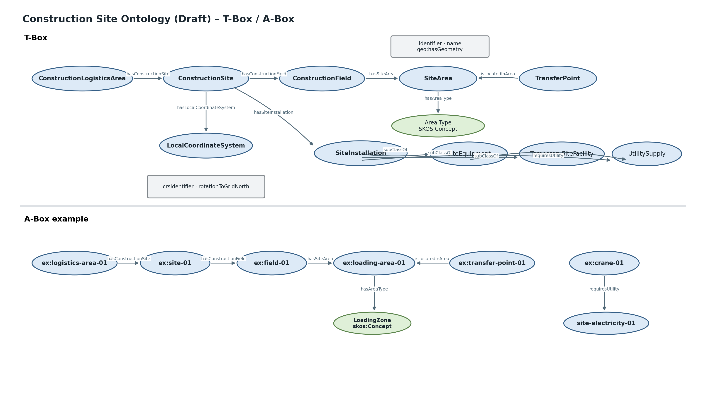

# Construction Site Ontology (Draft)

**Namespace:** `https://www.construct-x.org/ontology/construction-site#`  
**Version:** `0.1.0`  
**Prefix:** `conx-site`

Die Ontologie beschreibt die Baustelle als Produktionsumgebung und bildet die physische und organisatorische Baustellenstruktur, operative Baustellenflächen, Übergabepunkte, Baustelleneinrichtungen, Geräte und Medienversorgung ab.

## Klassen

| Klasse | Deutsch | Fachliche Beschreibung |
|---|---|---|
| `ConstructionLogisticsArea` | Baulogistikareal | Gesamter Wirkbereich der Baulogistik, auch außerhalb der Baustelle. |
| `ConstructionSite` | Baustelle | Projektbezogene Baustelle als Produktionsumgebung. |
| `ConstructionField` | Baufeld | Räumlich abgegrenzter Bereich innerhalb der Baustelle. |
| `SiteArea` | Baustelleneinrichtungsfläche | Konkrete operative oder logistische Fläche. |
| `TransferPoint` | Übergabepunkt | Definierter Ort der Material-, Obhuts- oder Verantwortungsübergabe. |
| `LocalCoordinateSystem` | Lokales Koordinatensystem | Baustellenspezifisches räumliches Referenzsystem. |
| `SiteInstallation` | Baustelleneinrichtung | Oberklasse temporärer Produktionsmittel und Infrastruktur. |
| `SiteEquipment` | Baustellengerät | Gerät für Produktion oder Logistik. |
| `TemporarySiteFacility` | Temporäre Baustelleneinrichtung | Temporäre Einrichtung, z. B. Container. |
| `UtilitySupply` | Medienversorgung | Baustrom, Bauwasser usw. |

## Wesentliche Beziehungen

| Quelle | Property | Ziel |
|---|---|---|
| `ConstructionLogisticsArea` | `hasConstructionSite` | `ConstructionSite` |
| `ConstructionLogisticsArea` | `hasExternalSiteArea` | `SiteArea` |
| `ConstructionSite` | `hasConstructionField` | `ConstructionField` |
| `ConstructionSite` | `hasLocalCoordinateSystem` | `LocalCoordinateSystem` |
| `ConstructionSite` | `hasSiteInstallation` | `SiteInstallation` |
| `ConstructionField` | `hasSiteArea` | `SiteArea` |
| `SiteArea` | `hasAreaType` | `skos:Concept` |
| `TransferPoint` | `isLocatedInArea` | `SiteArea` |
| `SiteInstallation` | `usesSiteArea` | `SiteArea` |
| `SiteInstallation` | `requiresUtility` | `UtilitySupply` |
| `SiteEquipment` | `hasRestrictedZone` | `SiteArea` |
| `SiteEquipment` | `hasEquipmentType` | `skos:Concept` |
| `TemporarySiteFacility` | `hasFacilityType` | `skos:Concept` |
| `UtilitySupply` | `hasUtilityType` | `skos:Concept` |
| `LocalCoordinateSystem` | `referencePoint` | `geo:Geometry` |

Die Geometrie einer `SiteArea` wird über den GeoSPARQL-Standard `geo:hasGeometry` / `geo:Geometry` modelliert. Eine eigene Polygon- oder Eckpunktontologie wird bewusst vermieden.

## Vokabulare

- `construction-site/area-type`
- `construction-site/equipment-type`
- `construction-site/facility-type`
- `construction-site/utility-type`

Die konkreten Typen sind SKOS-Konzepte und keine OWL-Klassen.

## SHACL

Core:
`https://www.construct-x.org/shapes/construction-site/core/0.1.0`

Vokabularprofil:
`https://www.construct-x.org/shapes/construction-site/vocabularies/0.1.0`

Anwendungsprofil Baustellenlogistik:
`https://www.construct-x.org/shapes/construction-site/site-logistics/0.1.0`

Das Logistikprofil prüft u. a.:
- zulässige Flächentypen für Übergabepunkte,
- Kran: genau eine Aufstellfläche, genau eine Sperrzone, Baustrom,
- Bauaufzug: genau eine Aufstellfläche, Baustrom,
- Container: genau eine Aufstellfläche und Baustrom,
- Sanitärcontainer zusätzlich Bauwasser,
- Lagerhilfsmittel mindestens eine Stellfläche.

## Abgrenzung

Nicht Bestandteil des Core sind:
- detaillierte Anlieferungsprozesse,
- Bauwerk-/Geschosssemantik,
- IFC- oder BOT-Klassen,
- Terminplanvorgänge,
- BoQ-Mengen.

Diese Bezüge werden über Standards oder separate Link-Ontologien hergestellt.

## Ontologievisualisierung

