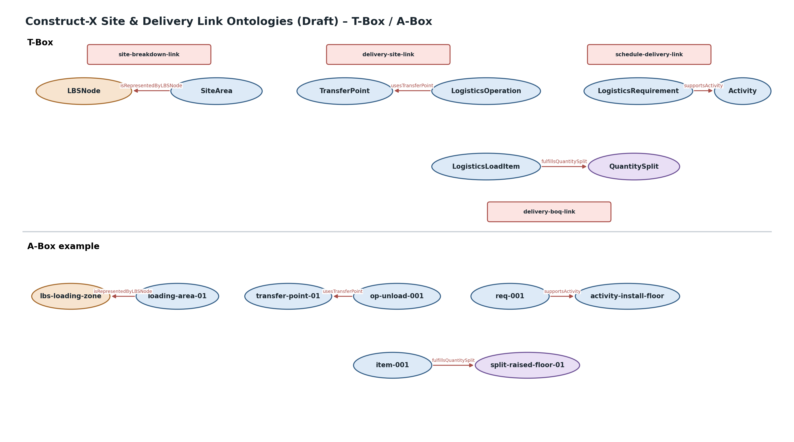

# Construct-X Site & Delivery Link Ontologies (Draft)

Domänenübergreifende Beziehungen werden gemäß der Construct-X-Modellierungsregel ausschließlich in separaten Link-Ontologien definiert.

## Übersicht

| Link-Ontologie | Verknüpfung | Property |
|---|---|---|
| `site-breakdown-link` | Site ↔ Breakdown | `isRepresentedByLBSNode` / `representsSiteArea` |
| `delivery-site-link` | Delivery ↔ Site | `usesTransferPoint` |
| `schedule-delivery-link` | Schedule ↔ Delivery | `supportsActivity` / `requiresLogisticsRequirement` |
| `delivery-boq-link` | Delivery ↔ BoQ | `fulfillsQuantitySplit` |

## Architektur

```text
Breakdown Structure
       ▲
       │ site-breakdown-link
       │
Construction Site
       ▲
       │ delivery-site-link
       │
Construction Delivery
    ▲          ▲
    │          │
schedule-   delivery-
delivery    boq-link
    │          │
Schedule    GAEB BoQ
```

Damit bleibt:
- **Wo?** in `construction-site`,
- **Was passiert bei der Anlieferung?** in `construction-delivery`,
- **Wann / für welchen Vorgang?** im Schedule,
- **welche Menge / LV-Zuordnung?** in GAEB BoQ.

## T-Box / A-Box


